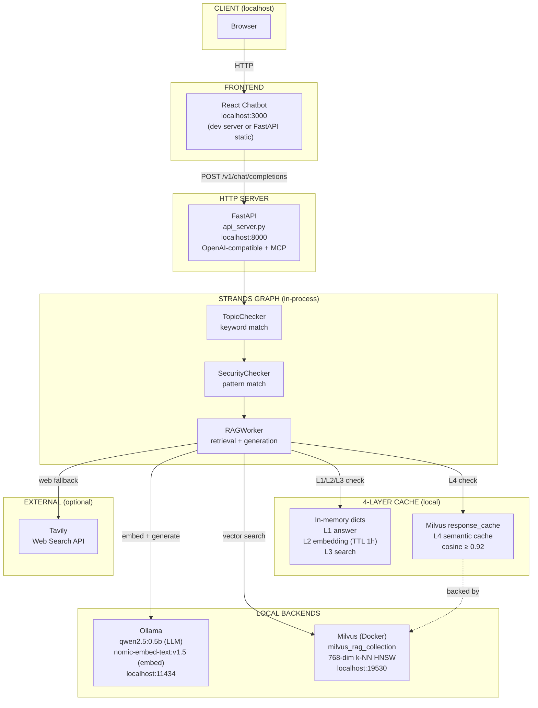
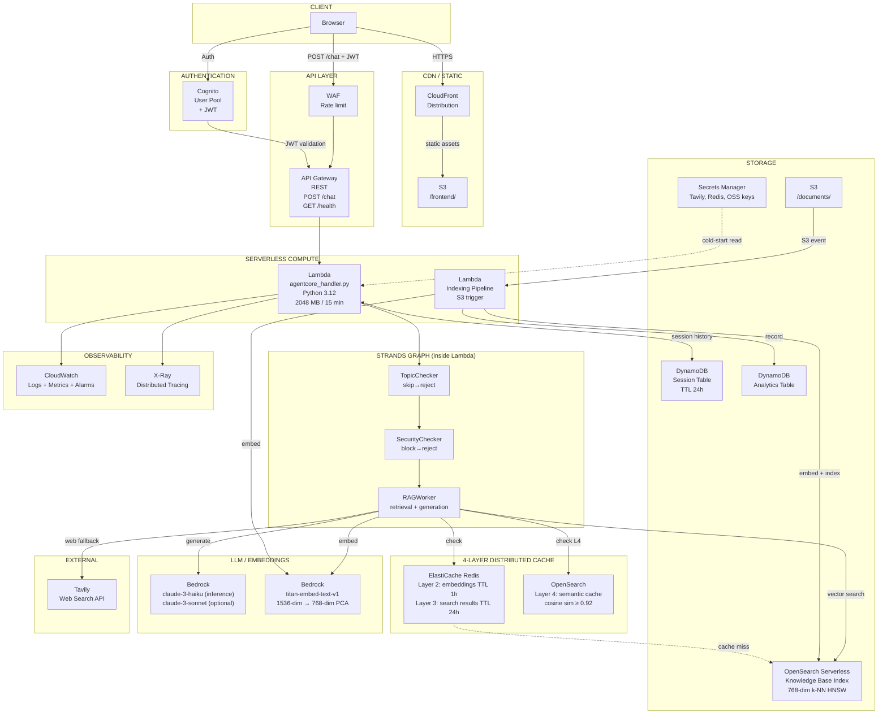

# Design Document: Dual-Mode Deployment (Local Strands + Serverless AWS)

## Overview

This design documents a **dual-mode deployment architecture** for the Strands Agents RAG application. The same core application runs in two first-class, fully supported modes:

- **Local Mode** (`deployment_mode = "local"`) — a self-contained developer stack running on `localhost`: FastAPI as the HTTP server, Ollama for LLM inference and embeddings, Milvus (via Docker) as the vector database, in-memory Python dictionaries for the hot cache layers, a Milvus `response_cache` collection for the semantic cache, and the React chatbot served locally. No cloud account or network dependency is required.
- **Serverless Mode** (`deployment_mode = "serverless"`) — a fully managed AWS deployment where every component maps to a managed service: Lambda + AgentCore for compute, Bedrock for inference/embeddings, OpenSearch Serverless for vector search, ElastiCache Redis + OpenSearch for the distributed cache, API Gateway + Cognito for the edge, and CloudFront + S3 for the frontend.

The two modes are **not** separate codebases. They share the same three-node Strands graph (`TopicChecker → SecurityChecker → RAGWorker`) and the same business logic. The only thing that changes between modes is which **backend clients** are injected into the graph. This is achieved through a dual-mode factory (`create_rag_graph`) that reads `settings.deployment_mode` and wires the appropriate backends. Local Mode uses `OllamaClient` + `MilvusVectorDB` + in-memory/Milvus caches; Serverless Mode uses `BedrockClient` + `OpenSearchClient` + `RedisCache`.

The core execution logic for Local Mode lives in `src/agents/strands_graph_agent.py` (`StrandsGraphRAGAgent`), driven by `api_server.py` (FastAPI). The core execution logic for Serverless Mode lives in `src/agents/agentcore_handler.py` (the Lambda entry-point). Both drive the identical graph.

### Goals

- Keep **Local Mode as a first-class deployment target** — fully documented, usable for development, demos, and offline/air-gapped operation with no AWS dependency.
- Provide a **cost-efficient Serverless Mode** on AWS with zero persistent EC2/container infrastructure.
- Preserve **all existing capabilities in both modes**: 4-layer cache, three-tier answer routing (Cache → KB → Web Search), Tavily web search fallback, conversation handling, and structured rejection for out-of-scope/malicious queries.
- Make **mode switching a configuration change only** (`deployment_mode` in `.env`/`settings.py`) — no code changes required to move between local and cloud.
- A single Terraform configuration (root module + child modules) deploys the entire serverless stack to `dev`, `staging`, or `prod` environments via per-environment `tfvars` (or Terraform workspaces), with state stored in a remote S3 backend locked by DynamoDB.
- The local Docker stack (`docker/docker-compose.yml`) remains fully supported and untouched by serverless work.

### Non-Goals

- Migrating to an ECS/Fargate container architecture — out of scope.
- Real-time WebSocket streaming in Serverless Mode — synchronous REST only for this iteration (local FastAPI streaming is unaffected).
- Multi-region active-active deployment.
- Running Ollama/Milvus inside Lambda — Local Mode backends are explicitly local-only.

---

## Local Mode (First-Class Deployment)

Local Mode is the default developer experience and a fully supported runtime target in its own right. It runs entirely on the developer's machine (plus Docker for Milvus) with no cloud dependency.

### Local Stack Components

| Layer | Local component | Entry-point / file | Endpoint |
|-------|-----------------|--------------------|----------|
| HTTP server | **FastAPI** (OpenAI-compatible API + MCP endpoints) | `api_server.py` | `http://localhost:8000` |
| LLM inference | **Ollama** running `qwen2.5:0.5b` | `src/tools/ollama_client.py` (`OllamaClient`) | `http://localhost:11434` |
| Embeddings | **Ollama** running `nomic-embed-text:v1.5` (768-dim) | `src/tools/ollama_client.py` (`OllamaClient`) | `http://localhost:11434` |
| Vector DB | **Milvus** standalone (Docker) | `src/tools/milvus_client.py` (`MilvusVectorDB`) | `localhost:19530` |
| Agent / graph | **StrandsGraphRAGAgent** (3-node Strands graph) | `src/agents/strands_graph_agent.py` | in-process |
| L1/L2/L3 cache | **In-memory Python dicts** (embedding, search, answer caches) | `strands_graph_agent.py` instance dicts | process-local |
| L4 semantic cache | **Milvus `response_cache` collection** | `src/tools/response_cache.py` (`MilvusResponseCache`) | `localhost:19530` |
| Web search | **Tavily** (optional, via API key) | `src/tools/web_search` client | external HTTPS |
| Frontend | **React chatbot** served via FastAPI static or local dev server | `chatbots/react-chatbot/` | `http://localhost:3000` |
| Config | **Local `.env`** file | `.env` / `src/config/settings.py` | n/a |
| Orchestration | **Docker Compose** (Milvus + etcd + MinIO + optional API/React) | `docker/docker-compose.yml` | n/a |

### Local Request Flow

```
Browser (localhost:3000)
  → React chatbot (dev server or FastAPI static)
  → FastAPI api_server.py (localhost:8000) POST /v1/chat/completions
    → StrandsGraphRAGAgent.answer_question()
      → TopicChecker (keyword match, in-process)  → reject if out-of-scope
      → SecurityChecker (pattern match, in-process) → reject if malicious
      → RAGWorker:
          L1/L2/L3 check: in-memory dicts (embedding / search / answer)
          L4 check: Milvus response_cache collection (cosine ≥ 0.92, entity validation)
          KB search: Milvus milvus_rag_collection (OllamaClient embedding → Milvus k-NN HNSW)
          generation: Ollama qwen2.5:0.5b
          web fallback (optional): Tavily when KB relevance < 0.15
    → FastAPI returns OpenAI-compatible JSON (answer + sources + timing)
  → React renders answer
```

### Local 4-Layer Cache

Local Mode implements the same conceptual 4-layer cache as the cloud, but with local backends:

| Layer | Purpose | Local backend | Lifetime |
|-------|---------|---------------|----------|
| L1 | Hot answer cache | In-memory `answer_cache` dict | Process lifetime |
| L2 | Query embedding cache | In-memory `embedding_cache` dict | Process lifetime (TTL via `EMBEDDING_CACHE_TTL`) |
| L3 | Search result cache | In-memory `search_cache` dict | Process lifetime |
| L4 | Semantic response cache | Milvus `response_cache` collection | Persistent across restarts |

L1–L3 are process-local and reset on restart (fast, zero-dependency). L4 persists in Milvus and is optionally pre-warmed on startup from `data/responses.json` when `ENABLE_CACHE_WARMUP=true`.

### Local Configuration (`.env`)

Local Mode is configured entirely through environment variables read by `src/config/settings.py`:

```env
# Mode selection
DEPLOYMENT_MODE=local

# Ollama (local inference + embeddings)
OLLAMA_HOST=http://localhost:11434
OLLAMA_MODEL=qwen2.5:0.5b
OLLAMA_EMBED_MODEL=nomic-embed-text:v1.5

# Milvus (local vector DB via Docker)
MILVUS_HOST=localhost
MILVUS_PORT=19530
MILVUS_DB_NAME=knowledge_base
MILVUS_INDEX_TYPE=HNSW
MILVUS_METRIC_TYPE=COSINE
MILVUS_HNSW_M=30
MILVUS_HNSW_EF_CONSTRUCTION=200

# Embeddings / cache
EMBEDDING_DIM=768
RESPONSE_CACHE_COLLECTION_NAME=response_cache
RESPONSE_CACHE_THRESHOLD=0.92
ENABLE_CACHE_WARMUP=true

# FastAPI
API_PORT=8000

# Web search (optional)
TAVILY_API_KEY=
WEB_SEARCH_FALLBACK_THRESHOLD=0.15
```

### Running Local Mode

```bash
# 1. Start Milvus (+ etcd + MinIO) via Docker
cd docker && docker-compose up -d milvus

# 2. Ensure Ollama is running with the required models
ollama serve
ollama pull qwen2.5:0.5b
ollama pull nomic-embed-text:v1.5

# 3. Start the FastAPI server (serves API + optional React static)
python api_server.py        # → http://localhost:8000

# 4. (Optional) Start the React chatbot dev server
cd chatbots/react-chatbot && npm start   # → http://localhost:3000
```

`docker/docker-compose.yml` can also bring up the full stack (Milvus, the `rag-api` FastAPI container, and the `rag-react` chatbot) together. In that compose setup the React container reads `REACT_APP_API_HOST` / `REACT_APP_API_PORT` and the API container points at the `milvus` service hostname.

---

## Deployment Mode Switch

The deployment mode is controlled by a single setting, `deployment_mode`, exposed in `src/config/settings.py` and overridable via the `DEPLOYMENT_MODE` environment variable in `.env`.

```python
# src/config/settings.py
deployment_mode: Literal["local", "serverless"] = Field(
    default="local",
    validation_alias="DEPLOYMENT_MODE",
    description='Deployment mode: "local" (Ollama + Milvus + FastAPI) or '
                '"serverless" (Bedrock + OpenSearch + Lambda).',
)
```

> Compatibility note: the existing boolean `use_agentcore` setting is retained and derived from `deployment_mode` (`use_agentcore == (deployment_mode == "serverless")`) so existing configuration continues to work during migration. New code should read `deployment_mode`.

### How the mode is detected

- **Explicit configuration**: `DEPLOYMENT_MODE` in `.env` (or `settings.deployment_mode`) is the single source of truth.
- **Entry-point default**: when the app is driven by `api_server.py` (FastAPI), the effective default is `local`. When driven by `agentcore_handler.lambda_handler` (Lambda), the handler asserts/forces `serverless`.
- The `create_rag_graph` factory reads `settings.deployment_mode` once at construction time and selects backends accordingly.

### What changes between modes

| Concern | `deployment_mode = "local"` | `deployment_mode = "serverless"` |
|---------|-----------------------------|----------------------------------|
| Entry-point | `api_server.py` (FastAPI, long-running) | `agentcore_handler.lambda_handler` (per-invocation) |
| LLM inference | `OllamaClient` → `qwen2.5:0.5b` | `BedrockClient` → `claude-3-haiku` |
| Embeddings | `OllamaClient` → `nomic-embed-text:v1.5` (768-dim) | `BedrockClient` → `titan-embed-text-v1` (1536→768-dim PCA) |
| Vector DB | `MilvusVectorDB` (`localhost:19530`) | `OpenSearchClient` (OpenSearch Serverless, VPC) |
| L2/L3 cache | In-memory dicts | `RedisCache` (ElastiCache) |
| L4 semantic cache | Milvus `response_cache` collection | OpenSearch `rag-cache` index |
| Session history | In-process / stateless per request | DynamoDB session table (TTL 24h) |
| Frontend | FastAPI static or local dev server | S3 + CloudFront |
| Auth | None (local trust) | Cognito JWT via API Gateway |
| Secrets | `.env` file | AWS Secrets Manager |
| Observability | Local logging | CloudWatch Logs/Metrics + X-Ray |

What stays identical across both modes: the three Strands graph nodes and their logic, the three-tier routing decisions, temporal-keyword cache bypass, the 0.92 semantic-cache threshold, the 0.15 web-search fallback threshold, entity validation, and the response schema shape.

---

## Architecture

The system presents two architecture topologies selected by `deployment_mode`. Both drive the same three-node Strands graph.

### Local Mode Architecture



### Serverless Mode Architecture



### Request Flow (Serverless, Happy Path — Cache Hit)

```
Browser → CloudFront → API Gateway → Lambda
  Lambda reads session from DynamoDB
  TopicChecker → passes
  SecurityChecker → passes
  RAGWorker: check Redis (L2 embedding hit) → check Redis (L3 search hit) → check OpenSearch L4 (cosine ≥ 0.92)
    → return cached answer
  Lambda writes Q/A to DynamoDB session (TTL 24h)
  Lambda returns answer to API Gateway → Browser
```

### Request Flow (Serverless, Cache Miss — Full RAG)

```
Browser → … → Lambda
  RAGWorker: Redis miss → OpenSearch L4 miss → vector search OpenSearch KB (top-k 10)
    → Bedrock embedding for query → Bedrock claude-3-haiku for generation
    → store in Redis (L3) and OpenSearch (L4)
  Lambda returns answer
```

### Request Flow (Serverless, KB insufficient — Web fallback)

```
  RAGWorker: relevance score < 0.15 → Tavily API search → return web-sourced answer
```

The local request flow is documented in the Local Mode section above; it mirrors these flows using in-memory/Milvus caches and Ollama instead of Redis/OpenSearch/Bedrock.

---

## Components and Interfaces

Every component has a **local equivalent** and a **cloud equivalent**. The graph is written against abstract roles (LLM client, vector store, cache) and the factory injects the concrete implementation per mode.

### Component Equivalence (Local vs Cloud)

| Role | Local Mode | Serverless Mode | Shared interface |
|------|------------|-----------------|------------------|
| HTTP entry-point | `api_server.py` (FastAPI) | `agentcore_handler.py` (Lambda) | drives the Strands graph |
| LLM inference | `OllamaClient` (`qwen2.5:0.5b`) | `BedrockClient` (`claude-3-haiku`) | `generate(prompt, ...) -> str` |
| Embeddings | `OllamaClient` (`nomic-embed-text:v1.5`, 768-dim) | `BedrockClient` (`titan-embed-text-v1`, 1536→768-dim) | `embed_text(text) -> list[float]` |
| Vector store | `MilvusVectorDB` (`localhost:19530`) | `OpenSearchClient` (OpenSearch Serverless) | `knn_search`, `index_document` |
| L2/L3 cache | In-memory dicts | `RedisCache` (ElastiCache) | `get/set_embedding`, `get/set_search_results` |
| L4 semantic cache | `MilvusResponseCache` (`response_cache` collection) | `OpenSearchClient` (`rag-cache` index) | `search_semantic_cache`, `store_semantic_cache` |
| Session history | stateless / in-process | DynamoDB session table | conversation history fetch/persist |
| Frontend hosting | FastAPI static / local dev server | S3 + CloudFront | serves React build |
| Auth | none (local trust) | Cognito JWT | request authorization |
| Secrets | `.env` | Secrets Manager | runtime secret access |
| Web search | `Tavily` client | `Tavily` client (key from Secrets Manager) | `search(query) -> results` |
| Observability | local logging | CloudWatch + X-Ray | structured logs/metrics |

### 1. HTTP Entry-Points

#### 1a. FastAPI Server (`api_server.py`) — Local Mode

Long-running OpenAI-compatible HTTP server. Initialises a single `StrandsGraphRAGAgent` on startup (with graceful degradation if Milvus is unavailable), exposes `/v1/chat/completions`, `/health`, `/health/detailed`, `/metrics`, and MCP endpoints. Serves the React build as static assets or coexists with the React dev server on port 3000. Streaming responses are supported via `StreamingResponse`.

#### 1b. Lambda Handler (`agentcore_handler.py`) — Serverless Mode

Entry-point for all chat requests. Replaces the placeholder stub with a real implementation.

**Interface** (API Gateway Proxy Integration):

```python
# Input event (from API Gateway)
{
  "body": "{\"question\": \"...\", \"session_id\": \"uuid\", \"force_web_search\": false, \"top_k\": 10}",
  "headers": {"Authorization": "Bearer <jwt>"},
  "requestContext": {"requestId": "..."}
}

# Output
{
  "statusCode": 200,
  "headers": {"Content-Type": "application/json"},
  "body": "{\"answer\": \"...\", \"sources\": [...], \"tier_used\": \"cache|kb|websearch\",
            \"session_id\": \"...\", \"latency_ms\": 320, \"web_search_unavailable\": false}"
}
```

**Responsibilities:**
- Parse and validate request body; return HTTP 400 for malformed input or invalid `top_k`.
- Load conversation history from `DynamoDB_Session_Table` keyed on `session_id`.
- Initialise `AgentCoreRuntime` and inject `BedrockClient`, `OpenSearchClient`, `RedisCache`, `TavilyClient`, `DynamoDBClient`.
- Invoke the Strands graph and collect `GraphExecutionResult`.
- Persist Q/A pair to `DynamoDB_Session_Table` with `ttl = now + 86400`.
- Emit structured JSON log and custom CloudWatch metrics.
- Return HTTP 500 with `{error_code, message}` on unhandled exceptions.

### 2. LLM / Embedding Clients

#### 2a. OllamaClient (`src/tools/ollama_client.py`) — Local Mode

Existing client, unchanged. Provides `embed_text`/`embed_texts` (768-dim via `nomic-embed-text:v1.5`), `generate`/`generate_stream` (via `qwen2.5:0.5b`), connection pooling, retries, and availability checks against `http://localhost:11434`.

#### 2b. BedrockClient (`src/tools/bedrock_client.py`) — Serverless Mode (new)

Replaces `OllamaClient` in cloud mode. Wraps `boto3.client("bedrock-runtime")`.

```python
class BedrockClient:
    def embed_text(self, text: str) -> list[float]:
        """Calls titan-embed-text-v1, returns 1536-dim vector, applies PCA to 768-dim."""

    def generate(self, prompt: str, model_id: str | None = None,
                 temperature: float = 0.3, max_tokens: int = 1024) -> str:
        """Calls claude-3-haiku (default) or override model. Retries 3× on HTTP 429."""
```

Dimensionality reduction: Titan Embed v1 returns 1536-dim vectors; the OpenSearch KB index is configured for 768-dim to match the existing `nomic-embed-text:v1.5` dimension used by Local Mode. A deterministic PCA projection matrix (pre-computed offline, stored in S3) is applied at embedding time.

**Rationale**: Keeping 768-dim preserves a single index schema shared conceptually with the local Milvus collection and reduces OpenSearch storage cost. An alternative is reconfiguring OpenSearch for 1536-dim — simpler but doubles storage and diverges from the local dimension. PCA preserves the most variance and is a one-time offline step.

### 3. Vector Stores

#### 3a. MilvusVectorDB (`src/tools/milvus_client.py`) — Local Mode

Existing client, unchanged. Wraps `pymilvus.MilvusClient` against `localhost:19530`. Provides `create_collection` (HNSW `M=30`, `efConstruction=200`, COSINE), `search` (k-NN), `insert_embeddings`, and collection management. Backs both the KB collection (`milvus_rag_collection`) and the L4 `response_cache` collection.

#### 3b. OpenSearchClient (`src/tools/opensearch_client.py`) — Serverless Mode (new)

Wraps the [opensearch-py](https://pypi.org/project/opensearch-py/) library against the OpenSearch Serverless endpoint.

```python
class OpenSearchClient:
    def knn_search(self, index: str, query_vector: list[float],
                   k: int = 10) -> list[dict]:
        """k-NN search using HNSW (m=30, ef_construction=200)."""

    def index_document(self, index: str, doc_id: str, vector: list[float],
                       text: str, metadata: dict) -> None:
        """Index a single chunk."""

    def search_semantic_cache(self, query_vector: list[float],
                               threshold: float = 0.92) -> dict | None:
        """Cosine-similarity search against the semantic cache index."""

    def store_semantic_cache(self, question: str, query_vector: list[float],
                              answer: str, sources: list[dict]) -> None:
        """Upsert a cache entry into the semantic cache index."""
```

Two OpenSearch indices (mirroring the two local Milvus collections):
- `rag-kb` — knowledge base documents (768-dim k-NN HNSW, cosine) — local equivalent: `milvus_rag_collection`.
- `rag-cache` — Layer 4 semantic cache (768-dim k-NN HNSW, cosine, no replication) — local equivalent: Milvus `response_cache` collection.

### 4. Caches

#### 4a. Local Caches — Local Mode

- **L1/L2/L3**: in-memory Python dicts on the `StrandsGraphRAGAgent` instance (`answer_cache`, `embedding_cache`, `search_cache`). Fast, zero-dependency, reset on restart. L2 honours `EMBEDDING_CACHE_TTL` (3600s).
- **L4**: `MilvusResponseCache` (`src/tools/response_cache.py`) — persistent semantic cache in the Milvus `response_cache` collection, cosine distance threshold 0.92 with entity validation to prevent cross-product cache hallucinations.

#### 4b. RedisCache (`src/tools/redis_cache.py`) — Serverless Mode (new)

Wraps `redis-py` against the ElastiCache Redis endpoint over TLS. Adapts the local in-memory L2/L3 behaviour to a distributed store shared across stateless Lambda invocations.

```python
class RedisCache:
    def get_embedding(self, cache_key: str) -> list[float] | None:
        """Layer 2: retrieve cached embedding vector. TTL 3600s."""

    def set_embedding(self, cache_key: str, vector: list[float]) -> None:
        """Layer 2: store embedding vector."""

    def get_search_results(self, cache_key: str) -> list[dict] | None:
        """Layer 3: retrieve cached OpenSearch results. TTL 86400s."""

    def set_search_results(self, cache_key: str, results: list[dict]) -> None:
        """Layer 3: store search results."""

    def ping(self) -> bool:
        """Health check — used to detect Redis unavailability."""
```

Cache keys use a SHA-256 hash of the normalised question text. Redis serialises vectors and result payloads with `msgpack` for efficiency. The L4 semantic cache in cloud mode is served by `OpenSearchClient` (`rag-cache` index), not Redis.

### 5. Strands Graph Nodes and the Dual-Mode Factory

The three nodes in `strands_graph_agent.py` are the **shared heart of both modes**. Their logic is identical regardless of deployment target — only the backends injected into the `RAGWorker` differ. The dual-mode factory is the key abstraction that makes a single codebase serve both local and cloud deployments.

| Node | Logic (identical in both modes) | Local backend | Serverless backend |
|------|---------------------------------|---------------|--------------------|
| `TopicChecker` | keyword scope matching (`_is_question_in_scope`) | none (pure) | none (pure) |
| `SecurityChecker` | jailbreak/injection pattern matching (`_is_security_attack`) | none (pure) | none (pure) |
| `RAGWorker` | retrieval + generation + 4-layer cache + web fallback | `OllamaClient` + `MilvusVectorDB` + in-memory/Milvus cache | `BedrockClient` + `OpenSearchClient` + `RedisCache`/OpenSearch cache |

`TopicChecker` and `SecurityChecker` are pure in-process functions with no backend dependency, so they behave identically in local and cloud — early exit for out-of-scope or malicious queries happens before any backend call in both modes.

#### The `create_rag_graph` Dual-Mode Factory

`create_rag_graph` is the single wiring point that selects backends based on `settings.deployment_mode`. It accepts optional pre-constructed clients (useful for tests and for Lambda cold-start reuse) and otherwise constructs the correct backends for the active mode.

```python
def create_rag_graph(
    settings: Settings,
    # Local-mode backends
    ollama_client: OllamaClient | None = None,
    milvus_client: MilvusVectorDB | None = None,
    # Serverless-mode backends
    bedrock_client: BedrockClient | None = None,
    opensearch_client: OpenSearchClient | None = None,
    redis_cache: RedisCache | None = None,
) -> GraphBuilder:
    """Build the three-node Strands graph with mode-appropriate backends.

    The deployment mode (settings.deployment_mode) determines which backend
    clients are injected into the RAGWorker node. TopicChecker and
    SecurityChecker are backend-agnostic and identical across modes.
    """
    if settings.deployment_mode == "serverless":
        llm = bedrock_client or BedrockClient(settings)
        vector_store = opensearch_client or OpenSearchClient(settings)
        cache = redis_cache or RedisCache(settings)
        semantic_cache = vector_store            # rag-cache index
    else:  # "local"
        llm = ollama_client or OllamaClient(host=settings.ollama_host)
        vector_store = milvus_client or MilvusVectorDB(host=settings.milvus_host,
                                                       port=settings.milvus_port)
        cache = InMemoryCache(ttl=settings.embedding_cache_ttl)
        semantic_cache = MilvusResponseCache(vector_store)   # response_cache collection

    # Nodes below are constructed identically; only `llm`, `vector_store`,
    # `cache`, and `semantic_cache` differ by mode.
    return build_graph(settings, llm, vector_store, cache, semantic_cache)
```

Design intent:
- **One graph definition, two backends.** The node logic never branches on mode; it calls the injected clients through their shared interfaces.
- **Mode is read once** at construction and never re-checked per request.
- **Local development keeps working with zero code changes** — the default `deployment_mode = "local"` path reproduces the current `StrandsGraphRAGAgent` behaviour exactly.
- **Testability**: both backend sets can be injected as mocks, so routing/property tests run without Ollama, Milvus, or AWS.

### 6. Indexing Pipeline

#### 6a. Local indexing — Local Mode

Local document loading uses the existing `document_loaders/` scripts: chunk documents (≤ 400 tokens), embed with `OllamaClient`, and insert into the Milvus `milvus_rag_collection` via `MilvusVectorDB.insert_embeddings`. Run manually/on demand; no event trigger.

#### 6b. Indexing Pipeline Lambda (`src/indexing/indexing_handler.py`) — Serverless Mode (new)

Triggered by S3 `ObjectCreated` events on the `/documents/` prefix.

```python
def lambda_handler(event: dict, context) -> None:
    for record in event["Records"]:
        bucket = record["s3"]["bucket"]["name"]
        key = record["s3"]["object"]["key"]
        etag = record["s3"]["object"]["eTag"]
        process_document(bucket, key, etag)
```

Steps per document:
1. Check `DynamoDB_Analytics_Table` for `(key, etag)` — skip if present (idempotent).
2. Download from S3 and split into ≤ 400-token chunks.
3. Generate embeddings with `BedrockClient.embed_text` (batched).
4. Index all chunks into `rag-kb` OpenSearch index.
5. Record `{key, etag, chunk_count, timestamp}` in `DynamoDB_Analytics_Table`.

### 7. React Frontend (both modes)

The same `chatbots/react-chatbot/` source serves both modes; only how it is hosted and configured differs.

- **Local Mode**: served by the FastAPI static mount or the React dev server on `http://localhost:3000`; reads `REACT_APP_API_HOST` / `REACT_APP_API_PORT` (defaults to `localhost:8000`); no authentication.
- **Serverless Mode**: build artifacts (`build/`) deployed to `S3_Document_Bucket/frontend/` via `aws s3 sync` and served through CloudFront; reads `REACT_APP_API_URL` (full HTTPS API Gateway URL); Amplify Auth added for Cognito sign-in with JWT held in memory.

### 8. Terraform Configuration (`infrastructure/terraform/`) — Serverless Mode only

The serverless stack is defined as a Terraform root module composed of focused child modules. Environment-specific values (stage name, Bedrock model ID, Redis node type, OpenSearch capacity) are supplied via per-environment `tfvars` files (or Terraform workspaces), so the same configuration deploys to `dev`, `staging`, and `prod` with no code changes.

#### Root module layout

```
infrastructure/terraform/
├── main.tf              # module composition + provider config
├── variables.tf         # input variables (stage, bedrock_model_id, redis_node_type, opensearch_capacity, ...)
├── outputs.tf           # api_gateway_url, cloudfront_domain, user_pool_id, ...
├── versions.tf          # terraform + required_providers (aws pinned, e.g. ~> 5.60)
├── backend.tf           # S3 remote state + DynamoDB state lock
├── environments/
│   ├── dev.tfvars
│   ├── staging.tfvars
│   └── prod.tfvars
└── modules/
    ├── networking/      # VPC, subnets, VPC endpoints, security groups
    ├── compute/         # Lambda chat + indexing functions, IAM role/policies
    ├── api/             # API Gateway + Cognito authorizer + WAF
    ├── data/            # DynamoDB tables, OpenSearch Serverless collection, ElastiCache Redis
    ├── frontend/        # S3 bucket + CloudFront distribution
    └── observability/   # CloudWatch alarms, log groups, X-Ray config
```

#### `versions.tf` — provider pinning

```hcl
terraform {
  required_version = ">= 1.6.0"
  required_providers {
    aws = {
      source  = "hashicorp/aws"
      version = "~> 5.60"   # pinned per Requirement 11.8
    }
  }
}
```

#### `backend.tf` — remote state

```hcl
terraform {
  backend "s3" {
    bucket         = "strands-rag-tfstate"      # S3 bucket for state storage
    key            = "serverless-deployment/terraform.tfstate"
    region         = "us-east-1"
    dynamodb_table = "strands-rag-tflock"       # DynamoDB table for state locking
    encrypt        = true
  }
}
```

The S3 state bucket and DynamoDB lock table are created once as a bootstrap step (or in a separate `bootstrap/` configuration) before the main configuration is initialised, so that concurrent team runs are safe (Requirement 11.7).

#### Child modules and the resources they define

- **`networking`** — VPC, private subnets (Lambda + Redis), VPC endpoints (OpenSearch Serverless, Bedrock, S3, DynamoDB, Secrets Manager), and `aws_security_group` rules. Uses the official [`terraform-aws-modules/vpc/aws`](https://registry.terraform.io/modules/terraform-aws-modules/vpc/aws/latest) registry module for the VPC/subnet/endpoint scaffolding where sensible, with a pinned version.
- **`compute`** — `aws_lambda_function` for the chat handler (`agentcore_handler.lambda_handler`) and the indexing handler (`indexing_handler.lambda_handler`), plus the Lambda execution `aws_iam_role` and least-privilege `aws_iam_policy` documents. Lambda VPC config attaches to the private subnets from `networking`.
- **`api`** — `aws_apigatewayv2_api` (HTTP API) or `aws_api_gateway_rest_api` (REST API) exposing `POST /chat` and `GET /health`, an `aws_cognito_user_pool` + `aws_cognito_user_pool_client` with a JWT authorizer, CORS configuration, and an `aws_wafv2_web_acl` with a rate-limit rule associated with the API stage.
- **`data`** — `aws_dynamodb_table` for the session and analytics tables (PAY_PER_REQUEST, TTL on `ttl`), an `aws_opensearchserverless_collection` (`rag-vectors`, VECTORSEARCH type) with its encryption/network/data-access policies, and an `aws_elasticache_replication_group` (Redis, TLS, 3-node) in private subnets.
- **`frontend`** — `aws_s3_bucket` (versioned, SSE) for documents + the `/frontend/` build artifacts, and an `aws_cloudfront_distribution` (HTTPS-only, 86400s default TTL, SPA routing to `index.html`). Secrets live in `aws_secretsmanager_secret` + `aws_secretsmanager_secret_version` (Tavily, Redis, OpenSearch access) — defined in `compute`/`data` as appropriate and referenced by the Lambda role.
- **`observability`** — `aws_cloudwatch_metric_alarm` (e.g. `errors/total > 10` in 5 minutes), `aws_cloudwatch_log_group` for each Lambda, and X-Ray active-tracing settings on the Lambda functions.

Key resource types used across the configuration: `aws_lambda_function`, `aws_api_gateway_rest_api` / `aws_apigatewayv2_api`, `aws_cognito_user_pool`, `aws_dynamodb_table`, `aws_opensearchserverless_collection`, `aws_elasticache_replication_group`, `aws_s3_bucket`, `aws_cloudfront_distribution`, `aws_secretsmanager_secret`, and `aws_wafv2_web_acl`.

Deployment workflow: `terraform init` (configures the S3 backend) → `terraform plan -var-file=environments/<env>.tfvars` (reviewed) → `terraform apply -var-file=environments/<env>.tfvars`. No manual AWS Console intervention is required (Requirement 11.3).

Local Mode has no IaC; it is provisioned by `docker/docker-compose.yml` (Milvus + etcd + MinIO + optional API/React containers).

---

## Data Models

### DynamoDB Session Table (Serverless Mode)

Partition key: `session_id` (String)
Sort key: `timestamp` (Number, Unix epoch ms)

```json
{
  "session_id": "550e8400-e29b-41d4-a716-446655440000",
  "timestamp": 1719000000000,
  "role": "user | assistant",
  "content": "...",
  "tier_used": "cache | kb | websearch",
  "ttl": 1719086400
}
```

Conversation history is fetched as: `query(session_id=X, ScanIndexForward=True, Limit=20)` to provide the last 20 turns as context. In Local Mode, conversation context is managed per request/process and is not persisted to DynamoDB.

### DynamoDB Analytics Table (Serverless Mode)

Partition key: `doc_key` (String — S3 object key)
Sort key: `etag` (String)

```json
{
  "doc_key": "documents/milvus_docs_en.pdf",
  "etag": "\"abc123\"",
  "chunk_count": 142,
  "indexed_at": "2024-06-21T12:00:00Z",
  "s3_uri": "s3://bucket/documents/milvus_docs_en.pdf"
}
```

Used for skip-deduplication in the indexing pipeline.

### Vector Document Schema (local Milvus `milvus_rag_collection` / cloud OpenSearch `rag-kb`)

```json
{
  "doc_id": "milvus_docs_en_chunk_042",
  "text": "HNSW is a graph-based ANN algorithm...",
  "embedding": [0.12, -0.34, ...],
  "metadata": {
    "source": "milvus_docs_en.pdf",
    "s3_uri": "s3://bucket/documents/milvus_docs_en.pdf",
    "chunk_index": 42,
    "chunk_total": 142
  }
}
```

Both backends use 768-dim vectors, cosine similarity, and HNSW with `m=30`, `ef_construction=200`. Local Milvus stores the vector in a `vector` field with an `int` primary `id` and a JSON `metadata` field; OpenSearch stores `embedding` as a `knn_vector` field type with method `hnsw`.

### Semantic Cache Schema (local Milvus `response_cache` / cloud OpenSearch `rag-cache`)

```json
{
  "question": "What is Milvus?",
  "embedding": [0.12, -0.34, ...],
  "answer": "Milvus is an open-source vector database...",
  "sources": [{"url": "...", "title": "..."}],
  "created_at": "2024-06-21T12:00:00Z"
}
```

In Local Mode this is the Milvus `response_cache` collection accessed via `MilvusResponseCache`; in Serverless Mode it is the OpenSearch `rag-cache` index. Both apply a 0.92 cosine threshold and entity validation.

### Redis Key Schema (Serverless Mode L2/L3)

| Key pattern | Value | TTL |
|-------------|-------|-----|
| `emb:{sha256(question)}` | msgpack-serialised `list[float]` | 3600s |
| `srch:{sha256(question)}:{top_k}` | msgpack-serialised `list[dict]` | 86400s |

In Local Mode the equivalent L2/L3 data lives in in-memory dicts keyed by the same normalised-question hash, with L2 honouring the `EMBEDDING_CACHE_TTL` of 3600s.

### Response Schema (both modes)

```json
{
  "answer": "string",
  "sources": [
    {"title": "string", "url": "string", "snippet": "string", "timestamp": "ISO8601"}
  ],
  "tier_used": "cache | kb | websearch",
  "session_id": "uuid",
  "latency_ms": 320,
  "confidence_score": 0.87,
  "web_search_unavailable": false
}
```

The local FastAPI server wraps this in the OpenAI-compatible `chat.completion` envelope (with `choices[].message`), while preserving `sources`, `timing`, and `response_type` for backward compatibility. The cloud Lambda returns the schema directly in the API Gateway proxy `body`.

Error response (Serverless Mode):
```json
{
  "error_code": "INVALID_TOP_K | INTERNAL_ERROR | UNAUTHORIZED",
  "message": "human-readable description"
}
```

### CloudWatch Metric Dimensions (Serverless Mode)

Namespace: `StrandsRAG/{Stage}`

| Metric | Unit | Description |
|--------|------|-------------|
| `cache/hit_rate` | Percent | L2+L3+L4 combined hit rate |
| `cache/miss_rate` | Percent | Cache miss rate |
| `cache/redis_unavailable` | Count | Redis unreachable events |
| `cache/opensearch_unavailable` | Count | OpenSearch L4 unreachable events |
| `rag/latency_p50` | Milliseconds | Median end-to-end latency |
| `rag/latency_p99` | Milliseconds | p99 latency |
| `websearch/invocation_count` | Count | Tavily calls per window |
| `errors/total` | Count | Unhandled exceptions |
| `indexing/document_skipped` | Count | Deduplication skips |
| `indexing/skip_enforcement_failure` | Count | Defect: re-index despite skip |

Local Mode exposes equivalent counters through the FastAPI `/metrics` endpoint (`GraphMetrics`) rather than CloudWatch.

---

## Correctness Properties

*A property is a characteristic or behavior that should hold true across all valid executions of a system — essentially, a formal statement about what the system should do. Properties serve as the bridge between human-readable specifications and machine-verifiable correctness guarantees.*

### Property 1: Request body parsing is total and correct

*For any* valid JSON request body containing arbitrary `question` strings, `session_id` UUID strings, and optional `force_web_search` booleans, the Lambda handler's parser SHALL extract exactly those three fields with their original values and types, without data loss or type coercion.

**Validates: Requirements 1.1**

---

### Property 2: Session persistence always writes with correct TTL

*For any* completed RAG pipeline invocation producing an arbitrary question/answer pair, the DynamoDB write SHALL store both the question and answer verbatim, and the `ttl` attribute SHALL equal `floor(invocation_unix_time) + 86400`.

**Validates: Requirements 1.4**

---

### Property 3: Unhandled exceptions always produce structured HTTP 500

*For any* exception type and message string raised inside the Lambda handler, the returned API Gateway response SHALL have `statusCode = 500` and a JSON body containing both `error_code` and `message` string fields (neither null nor absent).

**Validates: Requirements 1.5**

---

### Property 4: Cache hit at similarity ≥ 0.92 never calls the LLM backend

*For any* query whose embedding has cosine similarity ≥ 0.92 to a cached entry with non-empty answer content, the RAG pipeline SHALL return the cached answer and SHALL NOT invoke any LLM inference backend (Bedrock in serverless mode, Ollama in local mode) — neither embedding generation nor answer generation.

**Validates: Requirements 2.2**

---

### Property 5: Temporal keyword queries always bypass cache

*For any* query string that contains at least one temporal keyword from the set {`latest`, `recent`, `2024`, `2025`, `today`, `trending`, `current`, `now`}, the RAG pipeline SHALL skip all cache layers (L2/L3 and the L4 semantic cache) and perform a fresh vector search.

**Validates: Requirements 2.3**

---

### Property 6: Low-relevance KB results trigger web search fallback

*For any* set of vector search results whose average cosine similarity score is below 0.15, the RAG pipeline SHALL invoke Tavily web search and return web-sourced results rather than the low-relevance KB results.

**Validates: Requirements 2.4**

---

### Property 7: force_web_search always bypasses cache and KB

*For any* request with `force_web_search = true`, regardless of query content or cache state, the RAG pipeline SHALL invoke Tavily directly and SHALL NOT read from the L2/L3 cache, the L4 semantic cache, or the KB vector index.

**Validates: Requirements 2.6**

---

### Property 8: TopicChecker always prevents RAGWorker execution for out-of-scope queries

*For any* query string that does not contain any in-scope keyword (vector databases, embeddings, RAG, similarity search, etc.), the Strands graph SHALL return a structured rejection response, and the RAGWorker node SHALL NOT be invoked. This holds identically in local and serverless modes, since TopicChecker is backend-agnostic.

**Validates: Requirements 2.7**

---

### Property 9: SecurityChecker always prevents RAGWorker execution for injection queries

*For any* query string that contains at least one pattern from the known jailbreak/injection pattern list (as defined in `_is_security_attack`), the Strands graph SHALL return a structured rejection response, and the RAGWorker node SHALL NOT be invoked. This holds identically in local and serverless modes, since SecurityChecker is backend-agnostic.

**Validates: Requirements 2.8**

---

### Property 10: Cache write operations always set correct TTLs

*For any* embedding vector written to Redis Layer 2, the Redis TTL SHALL equal 3600 seconds. *For any* search result payload written to Redis Layer 3, the Redis TTL SHALL equal 86400 seconds. These invariants hold regardless of vector content or result payload size.

**Validates: Requirements 3.1, 3.2**

---

### Property 11: Embedding cache round-trip preserves the vector

*For any* text query and its computed embedding vector, storing the embedding in the cache and then requesting the embedding for the same query key SHALL return a vector whose values are identical to the stored vector (byte-for-byte after msgpack round-trip in Redis; reference-equal in the local in-memory cache).

**Validates: Requirements 3.4**

---

### Property 12: Search result cache threshold is enforced

*For any* cached search result stored at embedding key K, a subsequent query whose embedding is within L2 distance ≤ 0.05 from K SHALL return the cached search results without issuing a fresh vector-store query. A query with L2 distance > 0.05 SHALL issue a fresh vector-store query.

**Validates: Requirements 3.5**

---

### Property 13: Cache layer unavailability causes graceful degradation

*For any* query processed when Redis is unavailable, the RAG pipeline SHALL complete successfully (return a non-empty answer) and SHALL emit the `cache/redis_unavailable` CloudWatch metric. *For any* query processed when the OpenSearch semantic cache index is unreachable, the RAG pipeline SHALL proceed to KB vector search and emit the `cache/opensearch_unavailable` metric. In both cases the pipeline SHALL NOT propagate a 500 error to the caller. (The analogous local-mode guarantee is that a Milvus-unavailable startup degrades to validation-only without crashing.)

**Validates: Requirements 3.6, 3.7**

---

### Property 14: Vector search results are always ranked by cosine similarity (descending)

*For any* query vector and any collection of indexed document vectors, the `knn_search` function SHALL return results such that `results[i].score >= results[i+1].score` for all adjacent pairs — i.e., the result list is non-increasing in cosine similarity score.

**Validates: Requirements 4.2**

---

### Property 15: top_k validation is exhaustive over the integer domain

*For any* integer value of `top_k` in the closed range [1, 50], the Lambda handler SHALL accept the request and pass exactly that value to the OpenSearch k-NN query. *For any* integer value of `top_k` outside [1, 50], the Lambda handler SHALL return HTTP 400 with `error_code = "INVALID_TOP_K"` before invoking any agent node.

**Validates: Requirements 4.4**

---

### Property 16: Dimensionality reduction always produces 768-dimensional output

*For any* 1536-dimensional float vector returned by the Bedrock Titan embedding model, the dimensionality reduction function SHALL return a vector with exactly 768 elements. This invariant holds regardless of the input vector's magnitude, distribution, or content.

**Validates: Requirements 5.3**

---

### Property 17: Bedrock model ID override is always respected

*For any* non-empty model ID string set as `Bedrock_Model_Override` in settings, every call to `BedrockClient.generate` SHALL use that model ID and SHALL NOT use the default model ID `anthropic.claude-3-haiku-20240307-v1:0`.

**Validates: Requirements 5.4**

---

### Property 18: Bedrock retry on throttling obeys exponential backoff up to 3 attempts

*For any* sequence of N consecutive HTTP 429 responses from Bedrock (where N ≥ 1), the RAGWorker SHALL make exactly `min(N, 3)` retry attempts. The delay before each retry k SHALL be `500ms × 2^(k-1)` (i.e., 500ms, 1000ms, 2000ms). After 3 retries without success, the error SHALL be propagated.

**Validates: Requirements 5.5**

---

### Property 19: LLM prompts always include all retrieved document context

*For any* set of retrieved documents (of size 1 to `top_k`), the formatted LLM prompt string SHALL contain every document's source title and content chunk text. No document in the retrieved set SHALL be omitted from the prompt. This holds for both the local Ollama prompt and the serverless Bedrock prompt, which share the prompt template.

**Validates: Requirements 5.6**

---

### Property 20: Unauthenticated /chat requests are always rejected with HTTP 401

*For any* request to `POST /chat` that does not carry a valid, unexpired Cognito JWT — including requests with missing Authorization header, malformed tokens, expired tokens, and tokens with invalid signatures — the API Gateway SHALL return HTTP 401 and SHALL NOT invoke the Lambda handler.

**Validates: Requirements 6.3**

---

### Property 21: API Gateway always propagates Lambda error responses unchanged

*For any* error response body (arbitrary JSON string) and HTTP status code (4xx or 5xx) returned by the Lambda handler, the API Gateway SHALL return the same status code and the same body to the client, with no transformation.

**Validates: Requirements 6.6**

---

### Property 22: Password policy validation is correct for all password strings

*For any* candidate password string, the Cognito password policy validator SHALL accept the password if and only if: `len(password) >= 12` AND the string contains at least one uppercase letter AND at least one digit AND at least one special character. Any password failing one or more of these conditions SHALL be rejected.

**Validates: Requirements 7.1**

---

### Property 23: CloudFront cache headers are correct for every asset type

*For any* request to a path ending in `.js`, `.css`, `.png`, `.ico`, `.svg`, or `.woff2`, the CloudFront response SHALL include a `Cache-Control` header allowing caching with `max-age = 86400`. *For any* request to `/index.html` (directly or via SPA fallback), the `Cache-Control` header SHALL contain `no-store`.

**Validates: Requirements 8.3**

---

### Property 24: React build artifacts never contain localhost references

*For any* file in the React build output directory, the file content SHALL NOT contain the substring `"localhost"`. The API base URL SHALL be set exclusively via `REACT_APP_API_URL`. (This property applies to serverless-mode builds; local-mode development intentionally uses localhost via the dev server.)

**Validates: Requirements 8.4**

---

### Property 25: SPA routing always returns index.html for non-asset paths

*For any* URL path that does not end with a known static asset extension (`.js`, `.css`, `.png`, `.ico`, `.svg`, `.woff2`, `.map`, `.json`), the CloudFront distribution SHALL serve `index.html` with HTTP 200.

**Validates: Requirements 8.5**

---

### Property 26: Document chunking never produces chunks exceeding 400 tokens

*For any* input document text of arbitrary length and content, every chunk produced by the chunking function SHALL have a token count ≤ 400. This holds for both the local document loaders and the serverless indexing pipeline, which share the chunking logic.

**Validates: Requirements 9.2**

---

### Property 27: Indexing pipeline is idempotent on (key, ETag) pairs

*For any* document identified by an (S3 key, ETag) pair that has already been indexed, a second invocation of the indexing pipeline with the same (key, ETag) SHALL result in zero additional Bedrock embedding calls, zero additional OpenSearch index writes, and the OpenSearch document count for that key SHALL remain unchanged.

**Validates: Requirements 9.4**

---

### Property 28: Indexing pipeline always records all required DynamoDB fields

*For any* successfully indexed document, the DynamoDB Analytics Table entry SHALL contain all four required fields: `doc_key` (non-empty string), `s3_uri` (non-empty string starting with `s3://`), `chunk_count` (positive integer), and `indexed_at` (valid ISO 8601 timestamp).

**Validates: Requirements 9.5**

---

### Property 29: Tavily failure always sets web_search_unavailable flag

*For any* query that triggers a Tavily call that returns no results or times out, the Lambda response SHALL contain `web_search_unavailable = true` in the response metadata, and the `answer` field SHALL be non-empty (the best available KB answer). This holds in both modes, which share the Tavily fallback logic.

**Validates: Requirements 10.3**

---

### Property 30: Web search results always include sources with URL and timestamp

*For any* set of web search results returned by Tavily, the Lambda response `sources` array SHALL have an entry for each result, and every entry SHALL contain a non-empty `url` string and a non-empty `timestamp` string.

**Validates: Requirements 10.5**

---

### Property 31: Lambda IAM role contains only permitted actions

*For any* IAM action string in the Lambda execution role's policy — as defined by the Terraform `aws_iam_role` / `aws_iam_policy` resources (inspected via the HCL policy documents or the `terraform plan` JSON output) — that action SHALL appear in the permitted set: {`bedrock:InvokeModel`, `dynamodb:GetItem`, `dynamodb:PutItem`, `dynamodb:UpdateItem`, `dynamodb:DeleteItem`, `dynamodb:Query`, `elasticache:Connect`, `aoss:APIAccessAll`, `s3:GetObject`, `s3:ListBucket`, `secretsmanager:GetSecretValue`}. No wildcard actions (`*`) and no actions outside this set SHALL appear.

**Validates: Requirements 11.5**

---

### Property 32: Structured log entries always contain all required fields

*For any* Lambda invocation (cold start or warm, success or error), the emitted CloudWatch log entry SHALL be valid JSON and SHALL contain all of the following fields with non-null values: `request_id`, `session_id`, `tier_used`, `latency_ms`, `cache_hit`. *For any* cold-start invocation specifically, the log entry SHALL additionally contain `cold_start = true`.

**Validates: Requirements 12.1, 12.5**

---

### Property 33: Deployment mode selects backends deterministically

*For any* `Settings` object, `create_rag_graph` SHALL inject `BedrockClient` + `OpenSearchClient` + `RedisCache` when `deployment_mode == "serverless"`, and SHALL inject `OllamaClient` + `MilvusVectorDB` + in-memory/Milvus caches when `deployment_mode == "local"`. The selection SHALL depend only on `deployment_mode` and SHALL be stable across repeated construction with the same settings.

**Validates: Requirements 1.2, 5.1**

---

## Error Handling

### Lambda Handler (Serverless Mode)

| Error Condition | Action | Response |
|----------------|--------|----------|
| Malformed request JSON | Log warning, return immediately | HTTP 400, `error_code: "BAD_REQUEST"` |
| Missing `question` field | Return immediately | HTTP 400, `error_code: "MISSING_FIELD"` |
| `top_k` out of [1, 50] | Return immediately, no agent invoked | HTTP 400, `error_code: "INVALID_TOP_K"` |
| Missing/invalid JWT | API Gateway rejects before Lambda | HTTP 401 (from API Gateway) |
| DynamoDB session read failure | Log warning, proceed with empty history | Continue execution |
| DynamoDB session write failure | Log error, emit `errors/total` metric | Continue, return answer |
| Bedrock throttling (429) | Retry ×3 with exponential backoff (500ms base) | Propagate after 3 failures |
| Bedrock model error | Log error | HTTP 500, `error_code: "LLM_ERROR"` |
| Redis unavailable | Log warning, emit `cache/redis_unavailable`, skip L2/L3 | Continue without cache |
| OpenSearch L4 cache unreachable | Log warning, emit `cache/opensearch_unavailable`, skip L4 | Continue to KB |
| OpenSearch KB unreachable | Log error, fall back to Tavily | Attempt web search |
| Tavily timeout / no results | Log warning, return KB answer + flag | `web_search_unavailable: true` |
| TopicChecker rejection | Return rejection | HTTP 200, structured rejection body |
| SecurityChecker rejection | Return rejection | HTTP 200, structured rejection body |
| Unhandled exception | Log full stack trace, emit `errors/total` | HTTP 500, `error_code: "INTERNAL_ERROR"` |

### FastAPI Server (Local Mode)

| Error Condition | Action | Response |
|----------------|--------|----------|
| Milvus unavailable at startup | Log warning, start in DEGRADED MODE (validation only) | Server runs; KB search returns unavailable |
| Ollama unreachable | Log error, raise `RuntimeError` with remediation hint | 503 on dependent endpoints |
| Invalid/short user input | Sanitise + validate (`validate_user_input`) | HTTP 400 with reason |
| Suspicious input (XSS/injection patterns) | Reject in `validate_user_input` | HTTP 400 |
| Tavily timeout / no results | Return KB answer + `web_search_unavailable` note | 200 with flag |
| TopicChecker / SecurityChecker rejection | Return structured rejection | 200 with rejection body |
| Unhandled exception | Log, wrap via `_handle_api_error` | HTTP 500 |

### Indexing Pipeline (Serverless Mode)

| Error Condition | Action |
|----------------|--------|
| Document already indexed (same key+ETag) | Skip, log `indexing/document_skipped`, no error |
| Re-indexing was not prevented before logging | Emit `indexing/skip_enforcement_failure` metric |
| Bedrock embedding failure for a chunk | Log error for that chunk, skip it, continue |
| OpenSearch index write failure | Log error, retry once; if second failure, skip chunk and continue |
| DynamoDB analytics write failure | Log error; indexing is considered complete (best-effort audit) |

### Circuit Breaker Pattern (Serverless Mode)

The RAG pipeline implements a soft circuit breaker at the cache layer: if Redis ping fails on invocation, the instance-level `redis_available` flag is set to `False` for the remainder of the warm Lambda execution context. This prevents per-request connection attempts during a Redis outage from adding latency.

---

## Testing Strategy

This feature spans two deployment modes, AWS infrastructure wiring, Lambda/FastAPI business logic, and data transformation functions. The testing strategy uses three complementary layers. Because the Strands graph and routing logic are shared across modes, most property-based tests inject mock backends and therefore validate behaviour for both local and serverless modes simultaneously.

### Property-Based Tests (pytest + Hypothesis)

Property-based testing is appropriate for the pure-function and business-logic components: request parsing, cache key generation, TTL assignment, routing thresholds, dimensionality reduction, chunking, IAM policy analysis, log format validation, and dual-mode backend selection. Each property maps to a specific design property above.

**Library**: [Hypothesis](https://hypothesis.readthedocs.io/) (Python)
**Minimum iterations**: 100 per property (Hypothesis default setting `max_examples=100`)
**Tag format**: `# Feature: serverless-deployment, Property {N}: {property_text}`

Properties to implement as property-based tests:

| Design Property | Test File | What Hypothesis generates |
|-----------------|-----------|--------------------------|
| P1: Request parsing | `tests/test_handler_parsing.py` | Random JSON bodies with arbitrary string/bool/null fields |
| P2: Session TTL | `tests/test_handler_session.py` | Random Q/A strings, timestamps |
| P3: Error response format | `tests/test_handler_errors.py` | Random exception types and messages |
| P4: Cache hit avoids LLM backend | `tests/test_routing.py` | Cosine similarities around 0.92 threshold |
| P5: Temporal keyword bypass | `tests/test_routing.py` | Query strings with/without temporal keywords |
| P6: KB relevance threshold | `tests/test_routing.py` | Random relevance score sets |
| P7: force_web_search bypass | `tests/test_routing.py` | Random queries with flag set |
| P8: TopicChecker early exit | `tests/test_graph_nodes.py` | Random out-of-scope query strings |
| P9: SecurityChecker early exit | `tests/test_graph_nodes.py` | Query strings with injection patterns |
| P10: Cache TTLs | `tests/test_redis_cache.py` | Random vectors and result payloads |
| P11: Embedding round-trip | `tests/test_redis_cache.py` | Random float vectors |
| P12: Search result cache threshold | `tests/test_redis_cache.py` | Embedding pairs at varying L2 distances |
| P13: Graceful degradation | `tests/test_routing.py` | Random queries with mocked unavailable services |
| P14: Search result ordering | `tests/test_opensearch_client.py` | Random document/query vector collections |
| P15: top_k validation | `tests/test_handler_parsing.py` | Random integers across full int range |
| P16: Dimensionality reduction | `tests/test_bedrock_client.py` | Random 1536-dim float vectors |
| P17: Model ID override | `tests/test_bedrock_client.py` | Random model ID strings |
| P18: Bedrock retry backoff | `tests/test_bedrock_client.py` | 429 response sequences (N=0..4) |
| P19: Prompt includes all context | `tests/test_bedrock_client.py` | Random document sets |
| P20: JWT auth rejects invalid tokens | `tests/test_auth.py` | Random token strings (invalid, expired, etc.) |
| P21: API Gateway error passthrough | `tests/test_api_gateway.py` | Random error bodies and status codes |
| P22: Password policy | `tests/test_auth.py` | Random password strings |
| P23: CloudFront cache headers | `tests/test_cloudfront.py` | Random asset paths by extension |
| P24: No localhost in build | `tests/test_frontend_build.py` | Scans all built JS bundle files |
| P25: SPA routing | `tests/test_cloudfront.py` | Random URL paths |
| P26: Chunk max 400 tokens | `tests/test_indexing.py` | Random text documents |
| P27: Indexing idempotency | `tests/test_indexing.py` | Random documents, run twice |
| P28: DynamoDB analytics fields | `tests/test_indexing.py` | Random document metadata |
| P29: Tavily failure flag | `tests/test_routing.py` | Random queries, Tavily mocked |
| P30: Web source fields | `tests/test_routing.py` | Random Tavily result sets |
| P31: IAM policy scope | `tests/test_iam_policy.py` | Parse Terraform IAM HCL / `terraform plan` JSON output, enumerate actions |
| P32: Log field completeness | `tests/test_handler_logging.py` | Random requests (cold/warm, success/error) |
| P33: Dual-mode backend selection | `tests/test_graph_factory.py` | Random Settings with each `deployment_mode` |

### Unit / Example-Based Tests (pytest)

- `GET /health` → HTTP 200 with `{"status": "healthy"}` (Requirement 6.2)
- BedrockClient uses default model ID `anthropic.claude-3-haiku-20240307-v1:0` when no override (Requirement 5.1)
- BedrockClient uses `amazon.titan-embed-text-v1` for embeddings (Requirement 5.2)
- Session table query uses `ScanIndexForward=True, Limit=20` (Requirement 1.3)
- Local Mode: `OllamaClient` uses `qwen2.5:0.5b` for generation and `nomic-embed-text:v1.5` for embeddings
- Local Mode: `create_rag_graph` with default settings produces an Ollama + Milvus-backed graph
- Local Mode: FastAPI starts in DEGRADED MODE when Milvus is unreachable (validation nodes still work)

### Integration Tests

Serverless Mode (run against a deployed `dev` stage or AWS mocks / LocalStack):

- S3 upload → indexing Lambda triggered (Requirement 9.1)
- Cognito sign-in → JWT issued with 1-hour expiry (Requirement 7.2)
- Tavily API called within 10 seconds (Requirement 10.2)
- Secrets Manager queried once per cold start (Requirement 10.1)
- CloudWatch metrics appear after request (Requirement 12.2)
- Rate limiting returns HTTP 429 above 100 rps (Requirement 6.4)

Local Mode (run against the Docker Compose stack):

- `docker-compose up milvus` + Ollama → `POST /v1/chat/completions` returns an answer with sources
- Milvus `response_cache` collection warm-up loads Q&A pairs when `ENABLE_CACHE_WARMUP=true`
- React dev server (`localhost:3000`) reaches FastAPI (`localhost:8000`) end-to-end

### Smoke / Infrastructure Tests (Serverless Mode)

Run as part of `terraform apply` pre/post-deployment validation (against `terraform plan` JSON output and the deployed stack):

- `terraform fmt -check` and `terraform validate` pass for the root module and all child modules
- `terraform plan` shows all required resource types (`aws_lambda_function`, `aws_api_gateway_rest_api` / `aws_apigatewayv2_api`, `aws_cognito_user_pool`, `aws_dynamodb_table`, `aws_opensearchserverless_collection`, `aws_elasticache_replication_group`, `aws_s3_bucket`, `aws_cloudfront_distribution`, `aws_secretsmanager_secret`, `aws_wafv2_web_acl`, VPC/subnets/security groups) (Requirement 11.1)
- Remote state backend is configured: S3 state bucket + DynamoDB lock table present and referenced in `backend.tf` (Requirement 11.7)
- `required_providers` pins the aws provider version and module versions are version-constrained (Requirement 11.8)
- Lambda VPC configuration present in the Terraform configuration / plan (Requirement 11.4)
- DynamoDB tables defined with PAY_PER_REQUEST + TTL on `ttl` (Requirement 11.6)
- CloudWatch alarm configured at `errors/total > 10 / 5min` (Requirement 12.3)
- X-Ray active tracing enabled (Requirement 12.4)
- OpenSearch indexes use cosine similarity, 768-dim (Requirements 4.1, 3.3)
- HNSW parameters: m=30, ef_construction=200 (Requirement 4.6)
- Separate rag-kb and rag-cache indexes exist (Requirement 4.3)
- OpenSearch has no public endpoint (Requirement 4.5)
- CloudFront enforces HTTPS (Requirement 8.2)
- Frontend assets in S3 under /frontend/ (Requirement 8.1)
- Default models configured correctly (Requirements 5.1, 5.2)
- CORS headers present on /chat (Requirement 6.5)
