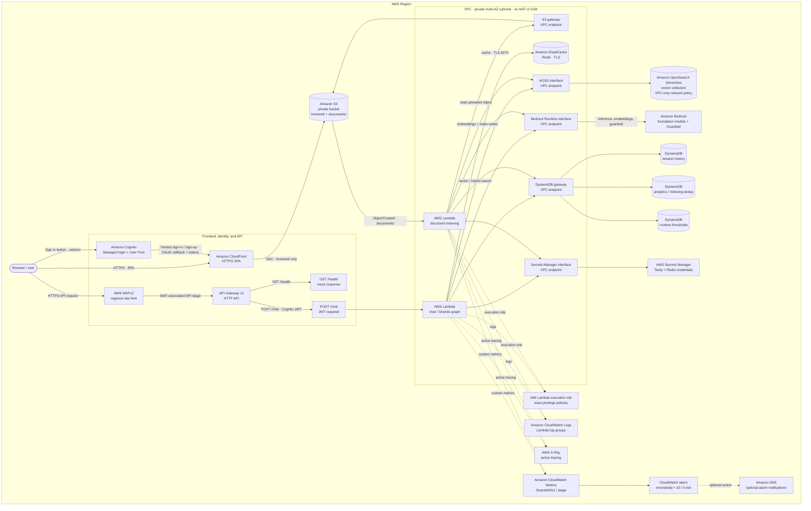

# Architecture

The current codebase supports two deployment modes with the same core Strands workflow:

- Local mode: FastAPI + Ollama + vector DB
- Serverless AWS mode: API Gateway + VPC-attached Lambda + Bedrock + OpenSearch Serverless

## Shared workflow

```text
User query
  -> TopicChecker
  -> SecurityChecker
  -> RAGWorker
     -> [hard-block hook: cancels tool calls on a security/injection attempt]
     -> retrieval backend (hybrid BM25 + vector k-NN by default; HYBRID_SEARCH_ENABLED)
     -> answer generation
     -> grounding check
          -> weak? one widened-retrieval retry, then caveat if still weak
     -> source output
```

The Strands graph is the shared application flow. The hard-block hook and the
grounding retry are anti-hallucination defenses; see
[docs/ANTI_HALLUCINATION.md](ANTI_HALLUCINATION.md) (Layers 3 and 4b) for the
full design. The difference between modes is the backend wiring, not the agent logic itself.
The graph uses a vector-store role rather than requiring one vendor's product.
OpenSearch is the vector engine in both modes — a local OpenSearch container for
local mode and OpenSearch Serverless for AWS mode; another provider needs a
compatible adapter and configuration.

Local mode routes answering through the same backend-agnostic `shared_route`
pipeline the serverless Lambda uses (via `LocalOpenSearchAgent`), giving dev/prod
parity on the OpenSearch engine. Embeddings stay Ollama (768-dim) locally and
Bedrock in serverless. `LOCAL_VECTOR_BACKEND` selects the local engine and
currently accepts only `opensearch`. See
[docs/GETTING_STARTED.md](GETTING_STARTED.md) for the setup steps.

Knowledge-base retrieval uses hybrid search by default: a vector k-NN search
and a BM25 search on chunk text are run separately and combined by weighted
Reciprocal Rank Fusion. `HYBRID_SEARCH_BM25_WEIGHT` and
`HYBRID_SEARCH_VECTOR_WEIGHT` weight the ranked lists, not the OpenSearch
similarity scores. The response order follows the fused RRF score, while
`distance` retains the raw vector score when available; lexical-only results
have no vector `distance`. The web-search fallback threshold continues to use
the average numeric vector relevance, not the RRF ranking score.

Local and serverless vector searches share the `VECTORDB_SEARCH_EF` recall
knob (OpenSearch `ef_search`, clamped to at least `top_k`). Optional metadata
filters are applied to both the vector and lexical searches when provided;
retrieval remains unfiltered by default. The semantic response-cache index
continues to use vector-only search. See
[docs/GETTING_STARTED.md](GETTING_STARTED.md) for configuration and tuning.

## Local mode

Local mode is the default path for development and debugging.

- FastAPI app in `api_server.py`
- Ollama for LLM and embeddings
- A local OpenSearch container for retrieval
- Docker Compose for the consolidated `agentcore-rag` local stack

## Serverless AWS mode

Serverless mode is the cloud deployment path. The graph below reflects the
Terraform-defined stack; [ADR-001](../ADR/ADR-001) records that the initial
cloud deployment is still pending.

- API Gateway HTTP API, with Cognito JWT authorization for chat requests
- VPC-attached chat and document-indexing Lambda functions
- Bedrock for inference and embeddings
- OpenSearch Serverless for vector search
- ElastiCache Redis for caching and DynamoDB for session, analytics, and thresholds
- CloudFront and a private S3 bucket for the static frontend and ingestion documents

### AWS serverless architecture graph



Solid arrows show request, event, or data paths; dotted arrows show IAM or
observability relationships. API Gateway's health route is a public mock
integration and does not invoke Lambda. The S3 bucket blocks public access:
CloudFront's origin access control reads only `frontend/`, while S3 object
creation under `documents/` invokes the indexing Lambda. Lambda traffic to
Bedrock, OpenSearch Serverless, Secrets Manager, S3, and DynamoDB uses the VPC
endpoints shown; Redis is reached directly inside the VPC. Redis and
OpenSearch are not publicly reachable. The frontend has no username/password
form: its sign-in button redirects to Cognito managed login, which returns to
the registered frontend callback. Local development remains unauthenticated by
default and does not include Cognito sign-in.

### Bedrock Guardrails

The Terraform stack creates a versioned Bedrock Guardrail and injects its ID
and version into the Lambda environment. When serverless mode has both values,
`BedrockClient` adds `guardrailConfig` to Converse requests. The RAG routing
path also uses `ApplyGuardrail` after generation when retrieved text is
available: it labels the user question as the query, the generated answer as
guarded content, and retrieved chunks as grounding sources. An intervention
replaces the generated answer; API errors are not silently ignored.

The current Terraform policy includes prompt-attack, hate/misconduct, denied
topic, PII, and contextual grounding/relevance filters. Email addresses are
anonymized; configured US and Canadian identifiers are blocked. The grounding
and relevance thresholds default to `0.7`. Trace is disabled by default.
Local mode does not call Bedrock Guardrails. See
[docs/GETTING_STARTED.md](GETTING_STARTED.md#bedrock-guardrails-serverless) for
the full policy and sensitive-data notes.

## Mode selection

The switch is controlled by `DEPLOYMENT_MODE` in `.env` and `src/config/settings.py`:

```env
DEPLOYMENT_MODE=local
# or
DEPLOYMENT_MODE=serverless
```

This is the actual source of truth in the current project. There is no supported legacy `use_agentcore` toggle in the live configuration.

## Runtime responsibilities

- `api_server.py` exposes the OpenAI-compatible REST API
- `src/config/settings.py` selects the active backend stack
- `src/agents/strands_graph_agent.py` builds the shared graph (`create_rag_graph`) and the topic/security/RAG routing
- `src/agents/local_opensearch_agent.py` is the local-mode agent facade over `shared_route`
- `src/agents/guardrail_hooks.py` adds a framework-level hard block on the RAGWorker's tool calls (see [docs/ANTI_HALLUCINATION.md](ANTI_HALLUCINATION.md) Layer 4b)
- `src/tools/` contains the retrieval, embedding, cache, and web-search clients
- The app captures sources and response metadata for the frontend and API callers

## Practical guidance

Use local mode when:
- you are developing locally
- you want Ollama with a local OpenSearch vector DB
- you need offline or quick demos

Use serverless mode when:
- you are deploying to AWS
- you want Bedrock/OpenSearch managed infrastructure
- you need the production cloud stack

See [docs/GETTING_STARTED.md](GETTING_STARTED.md) and [docs/API_SERVER.md](API_SERVER.md) for concrete setup instructions.
