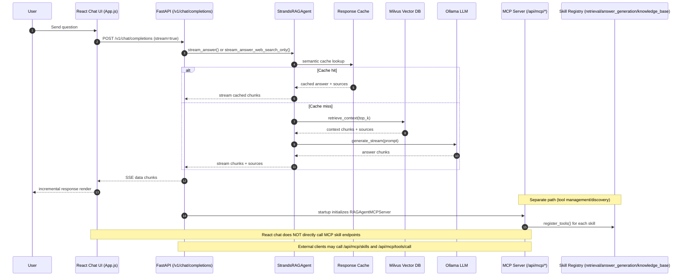

# Chat Request Flow and Skill Usage

This document shows the runtime path for a chat request from the React UI to the RAG backend, and where MCP skills fit.

## Mermaid Sequence Diagram

## Who Uses Skills and By Whom

- Skills are backend capability groups used by the MCP server to organize tools by category:
  - `retrieval`
  - `answer_generation`
  - `knowledge_base`
- The MCP server registers skills at startup and exposes them through MCP endpoints.
- External MCP/API consumers (developers, agent integrations, automation clients) can:
  - list skills (`GET /api/mcp/skills`)
  - read skill docs (`GET /api/mcp/skills/{skill_name}`)
  - invoke tools (`POST /api/mcp/tools/call`)
- The React chatbot path (`/v1/chat/completions`) primarily uses direct agent methods, not MCP skill endpoints.

## Related Files

- `chatbots/react-chatbot/src/App.js`
- `api_server.py`
- `src/mcp/mcp_server.py`
- `src/tools/tool_registry.py`
- `src/agents/skills/retrieval_skill.py`
- `src/agents/skills/answer_generation_skill.py`
- `src/agents/skills/knowledge_base_skill.py`
